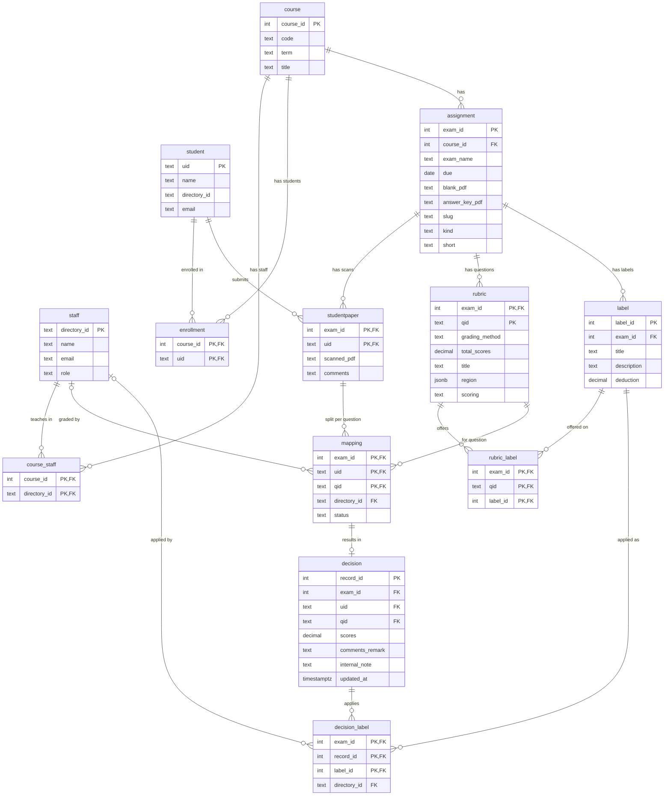

# GradeFlow Data Storage Overview

GradeFlow keeps its data in two places:

1. **PostgreSQL** holds people, courses, and everything about grading.
2. **JSON/files under `data/`** hold the exam upload and matching workflow, plus configuration.

Part 1 describes the SQL database, part 2 the JSON side, and part 3 where the two overlap.

---

## Part 1: The SQL database (PostgreSQL)

The schema is built by numbered migrations in `backend/app/migrations/`. `db.py` runs any that have not run yet at startup and records them in a `schema_migration` table.

| Migration | Adds |
|---|---|
| `001_staff_and_courses.sql` | `staff`, `course`, `course_staff` |
| `002_students.sql` | `student`, `enrollment` |
| `003_grading.sql` | `exam` (renamed to `assignment` in 006), `studentpaper`, `rubric`, `label`, `mapping`, `decision`, `rubric_label`, `decision_label`, `audit_outbox`, plus audit triggers |
| `004_rubric_scoring.sql` | `rubric.scoring` column (`add` or `deduct`) |
| `005_exam_slug.sql` | `exam.slug` column and a unique `(course_id, slug)` constraint |
| `006_assignment.sql` | Renames `exam` to `assignment`; adds `kind` and `short`; makes `slug` NOT NULL |

### How it is organized

The tables form three layers: people and courses, grading, and audit.

#### Entity-relationship diagram

This diagram uses Mermaid, so it renders on GitHub and in most Markdown previewers. `PK` means primary key and `FK` means foreign key. `||--o{` reads "one to many".



#### The same thing as a text map

If Mermaid doesn't render for you, this shows the same relationships. `──<` means "one to many".

```
 PEOPLE & COURSES
 ┌─────────┐      ┌──────────────┐      ┌─────────┐      ┌────────────┐      ┌─────────┐
 │  staff  │──<───│ course_staff │───>──│ course  │──<───│ enrollment │───>──│ student │
 └────┬────┘      └──────────────┘      └────┬────┘      └────────────┘      └────┬────┘
      │                                      │                                    │
 ─────┼──────────────────────────────────────┼────────────────────────────────────┼─────
 GRADING                                     │ one course has many assignments    │
      │                                 ┌────▼─────┐                           │
      │                                 │assignment│                            │
      │                                 └──┬──┬──┬─┘                           │
      │             ┌─────────────────────┘  │  └──────────────────┐              │
      │             │                        │                     │              │
      │        ┌────▼─────┐             ┌────▼────┐          ┌─────▼──────┐       │
      │        │  rubric  │             │  label  │          │studentpaper│◄──────┘
      │        └──┬────┬──┘             └──┬───┬──┘          └─────┬──────┘
      │           │    │  ┌──────────────┐ │   │                   │
      │           │    └─<│ rubric_label │>┘   │                   │
      │           │       └──────────────┘     │                   │
      │           │                            │                   │
      │           │      ┌─────────────────────┼───────────────────┘
      │           │      │                     │
      │        ┌──▼──────▼──┐                  │
      └───────<│  mapping   │  grader × student × question
      │        └─────┬──────┘                  │
      │              │ 0 or 1                  │
      │        ┌─────▼──────┐   ┌────────────────┐
      │        │  decision  │──<│ decision_label │>────────────┘
      │        └────────────┘   └───────┬────────┘
      └─────────────────────────────────┘  (grader who applied the label)

 AUDIT (no foreign keys, filled by triggers on every table above)
 ┌──────────────┐
 │ audit_outbox │ ──► logs/audit/audit-YYYY-MM-DD.jsonl
 └──────────────┘
```

#### Rules the schema does not enforce

The foreign keys do not check that a student is enrolled in the exam's course, or that a grader is staff of that course. The backend has to check these. The comments in `003_grading.sql` say so too.

### Tables, drawn out

For each table there is a column layout and a small sample. **The sample rows are made up for illustration and are not real data.** `PK` is primary key, `FK` is foreign key, and `NN` is NOT NULL.

#### `staff`
Instructors and TAs.

| Column | Type | Key | Notes |
|---|---|---|---|
| `directory_id` | TEXT | **PK** | Lowercase UMD directory ID |
| `name` | TEXT | NN | |
| `email` | TEXT | | |
| `role` | TEXT | NN | `instructor` or `ta` |

```
┌──────────────┬──────────────┬───────────────────┬────────────┐
│ directory_id │ name         │ email             │ role       │
├──────────────┼──────────────┼───────────────────┼────────────┤
│ lherman      │ Larry Herman │ lherman@umd.edu   │ instructor │
│ jdoe         │ Jane Doe     │ jdoe@umd.edu      │ ta         │
└──────────────┴──────────────┴───────────────────┴────────────┘
```

#### `course`
One course offering, such as CMSC250 in Fall 2026.

| Column | Type | Key | Notes |
|---|---|---|---|
| `course_id` | INT | **PK** | Auto-generated |
| `code` | TEXT | NN | |
| `term` | TEXT | NN | `UNIQUE (code, term)` |
| `title` | TEXT | | |

```
┌───────────┬─────────┬─────────────┬───────┐
│ course_id │ code    │ term        │ title │
├───────────┼─────────┼─────────────┼───────┤
│ 1         │ CMSC250 │ Fall 2026   │ NULL  │
└───────────┴─────────┴─────────────┴───────┘
```

#### `course_staff`
Which staff belong to which course. Many-to-many link table.

| Column | Type | Key | Notes |
|---|---|---|---|
| `course_id` | INT | **PK**, FK → `course` | Cascades on delete |
| `directory_id` | TEXT | **PK**, FK → `staff` | Cascades on delete |

```
┌───────────┬──────────────┐
│ course_id │ directory_id │
├───────────┼──────────────┤
│ 1         │ lherman      │
│ 1         │ jdoe         │
└───────────┴──────────────┘
```

#### `student`
Every student.

| Column | Type | Key | Notes |
|---|---|---|---|
| `uid` | TEXT | **PK** | Exactly 9 digits |
| `name` | TEXT | NN | |
| `directory_id` | TEXT | unique | Lowercase |
| `email` | TEXT | | |

```
┌───────────┬───────────────┬──────────────┬───────┐
│ uid       │ name          │ directory_id │ email │
├───────────┼───────────────┼──────────────┼───────┤
│ 123456789 │ Alex Rivera   │ arivera1     │ NULL  │
│ 987654321 │ Sam Chen      │ schen7       │ NULL  │
└───────────┴───────────────┴──────────────┴───────┘
```

#### `enrollment`
Which students are in which course. Many-to-many link table.

| Column | Type | Key | Notes |
|---|---|---|---|
| `course_id` | INT | **PK**, FK → `course` | Cascades on delete |
| `uid` | TEXT | **PK**, FK → `student` | Cascades on delete |

```
┌───────────┬───────────┐
│ course_id │ uid       │
├───────────┼───────────┤
│ 1         │ 123456789 │
│ 1         │ 987654321 │
└───────────┴───────────┘
```

#### `assignment`
Anything that gets graded: an exam, quiz, homework and so on. It was called `exam` until migration 006. Column names such as `exam_id` and `exam_name` were kept.

| Column | Type | Key | Notes |
|---|---|---|---|
| `exam_id` | INT | **PK** | Auto-generated |
| `course_id` | INT | FK → `course`, NN | Cascades on delete |
| `exam_name` | VARCHAR(100) | NN | |
| `due` | DATE | | |
| `blank_pdf` | TEXT | | File path |
| `answer_key_pdf` | TEXT | | File path |
| `slug` | TEXT | NN | Added in 005, NOT NULL since 006. Links to the assignment `id` in the JSON files. `UNIQUE (course_id, slug)` |
| `kind` | TEXT | NN | Added in 006. One of `exam`, `final exam`, `homework`, `lab`, `quiz`, `essay`, `other`. Default `exam` |
| `short` | TEXT | | Added in 006. Short label such as `Q1`. When NULL, callers fall back to `slug` |

```
┌─────────┬───────────┬───────────┬────────────┬───────────┬────────────────┬────────┬──────┬───────┐
│ exam_id │ course_id │ exam_name │ due        │ blank_pdf │ answer_key_pdf │ slug   │ kind │ short │
├─────────┼───────────┼───────────┼────────────┼───────────┼────────────────┼────────┼──────┼───────┤
│ 1       │ 1         │ Quiz 1    │ 2026-09-16 │ NULL      │ NULL           │ quiz-1 │ quiz │ Q1    │
└─────────┴───────────┴───────────┴────────────┴───────────┴────────────────┴────────┴──────┴───────┘
```

#### `studentpaper`
One student's scanned paper for one exam.

| Column | Type | Key | Notes |
|---|---|---|---|
| `exam_id` | INT | **PK**, FK → `assignment` | Cascades on delete |
| `uid` | TEXT | **PK**, FK → `student` | Cascades on delete |
| `scanned_pdf` | TEXT | NN | Path relative to `data/` |
| `comments` | TEXT | | |

```
┌─────────┬───────────┬──────────────────────────────────────────────┬──────────┐
│ exam_id │ uid       │ scanned_pdf                                  │ comments │
├─────────┼───────────┼──────────────────────────────────────────────┼──────────┤
│ 1       │ 123456789 │ submissions/quiz-1/up_01/exam_001.pdf        │ NULL     │
│ 1       │ 987654321 │ submissions/quiz-1/up_01/exam_002.pdf        │ NULL     │
└─────────┴───────────┴──────────────────────────────────────────────┴──────────┘
```

#### `rubric`
One gradable question on an exam.

| Column | Type | Key | Notes |
|---|---|---|---|
| `exam_id` | INT | **PK**, FK → `assignment` | Cascades on delete |
| `qid` | VARCHAR(50) | **PK** | Question ID, such as `Q1` |
| `grading_method` | VARCHAR(50) | NN | |
| `total_scores` | DECIMAL(5,2) | | Maximum points |
| `title` | TEXT | | |
| `region` | JSONB | | Where the question sits on the page |
| `scoring` | VARCHAR(10) | NN | Added in 004. `add` or `deduct`, default `add` |

```
┌─────────┬─────┬────────────────┬──────────────┬─────────────┬───────────────────────────┬─────────┐
│ exam_id │ qid │ grading_method │ total_scores │ title       │ region                    │ scoring │
├─────────┼─────┼────────────────┼──────────────┼─────────────┼───────────────────────────┼─────────┤
│ 1       │ Q1  │ rubric         │ 10.00        │ Induction   │ {"page":1,"rect":[...]}   │ deduct  │
│ 1       │ Q2  │ rubric         │ 5.00         │ Sets        │ {"page":2,"rect":[...]}   │ add     │
└─────────┴─────┴────────────────┴──────────────┴─────────────┴───────────────────────────┴─────────┘
```

#### `label`
A reusable rubric item for an exam, such as a standard deduction.

| Column | Type | Key | Notes |
|---|---|---|---|
| `label_id` | INT | **PK** | Auto-generated |
| `exam_id` | INT | FK → `assignment`, NN | Cascades on delete |
| `title` | VARCHAR(50) | NN | |
| `description` | TEXT | | |
| `deduction` | DECIMAL(5,2) | | Signed. Can be positive or negative |

```
┌──────────┬─────────┬──────────────────┬─────────────────────────┬───────────┐
│ label_id │ exam_id │ title            │ description             │ deduction │
├──────────┼─────────┼──────────────────┼─────────────────────────┼───────────┤
│ 1        │ 1       │ Off by one       │ Base case is wrong      │ -1.00     │
│ 2        │ 1       │ Missing proof    │ No inductive step given │ -4.00     │
└──────────┴─────────┴──────────────────┴─────────────────────────┴───────────┘
```

#### `rubric_label`
Which labels are available on which question. Many-to-many link table.

| Column | Type | Key | Notes |
|---|---|---|---|
| `exam_id` | INT | **PK**, FK | |
| `qid` | VARCHAR(50) | **PK**, FK → `rubric` | |
| `label_id` | INT | **PK**, FK → `label` | |

```
┌─────────┬─────┬──────────┐
│ exam_id │ qid │ label_id │
├─────────┼─────┼──────────┤
│ 1       │ Q1  │ 1        │
│ 1       │ Q1  │ 2        │
└─────────┴─────┴──────────┘
```

#### `mapping`
Assigns a grader to one student's answer to one question.

| Column | Type | Key | Notes |
|---|---|---|---|
| `exam_id` | INT | **PK**, FK | |
| `uid` | TEXT | **PK**, FK → `studentpaper` | |
| `qid` | VARCHAR(50) | **PK**, FK → `rubric` | |
| `directory_id` | TEXT | FK → `staff` | The grader. Becomes NULL if that staff row is deleted |
| `status` | VARCHAR(50) | | |

```
┌─────────┬───────────┬─────┬──────────────┬─────────┐
│ exam_id │ uid       │ qid │ directory_id │ status  │
├─────────┼───────────┼─────┼──────────────┼─────────┤
│ 1       │ 123456789 │ Q1  │ jdoe         │ graded  │
│ 1       │ 123456789 │ Q2  │ jdoe         │ pending │
└─────────┴───────────┴─────┴──────────────┴─────────┘
```

#### `decision`
The current grade for one assigned student-question.

| Column | Type | Key | Notes |
|---|---|---|---|
| `record_id` | INT | **PK** | Auto-generated |
| `exam_id` | INT | FK | |
| `uid` | TEXT | FK | |
| `qid` | VARCHAR(50) | FK → `mapping` | `UNIQUE (exam_id, uid, qid)` |
| `scores` | DECIMAL(5,2) | | Points given |
| `comments_remark` | TEXT | | Visible to the student |
| `internal_note` | TEXT | | Visible to graders only |
| `updated_at` | TIMESTAMPTZ | NN | |

```
┌───────────┬─────────┬───────────┬─────┬────────┬──────────────────┬───────────────┬─────────────────────┐
│ record_id │ exam_id │ uid       │ qid │ scores │ comments_remark  │ internal_note │ updated_at          │
├───────────┼─────────┼───────────┼─────┼────────┼──────────────────┼───────────────┼─────────────────────┤
│ 1         │ 1       │ 123456789 │ Q1  │ 6.00   │ Missing inductive│ check w/ prof │ 2026-09-20 14:02:11 │
│           │         │           │     │        │ step             │               │                     │
└───────────┴─────────┴───────────┴─────┴────────┴──────────────────┴───────────────┴─────────────────────┘
```

#### `decision_label`
Which labels were applied to a decision. Many-to-many link table.

| Column | Type | Key | Notes |
|---|---|---|---|
| `exam_id` | INT | **PK**, FK | |
| `record_id` | INT | **PK**, FK → `decision` | |
| `label_id` | INT | **PK**, FK → `label` | |
| `directory_id` | TEXT | FK → `staff` | The grader who applied it. NULL if that staff row is deleted |

```
┌─────────┬───────────┬──────────┬──────────────┐
│ exam_id │ record_id │ label_id │ directory_id │
├─────────┼───────────┼──────────┼──────────────┤
│ 1       │ 1         │ 2        │ jdoe         │
└─────────┴───────────┴──────────┴──────────────┘
```

In these samples, Q1 is worth 10 and uses `deduct`. The applied label "Missing proof" (-4.00) gives the 6.00 shown in the `decision` sample.

#### `audit_outbox`
A delivery queue for change events, not the history itself. A trigger writes a row here on every insert, update or delete of an audited table. It has no foreign keys, so deleting an exam cannot delete pending audit events.

| Column | Type | Notes |
|---|---|---|
| `event_id` | BIGINT **PK** | Auto-generated |
| `event_uuid` | UUID | |
| `occurred_at` | TIMESTAMPTZ | |
| `transaction_id` | BIGINT | |
| `schema_name`, `table_name` | TEXT | Which table changed |
| `operation` | TEXT | `INSERT`, `UPDATE`, `DELETE` or `BASELINE` |
| `row_key` | JSONB | Primary key of the changed row |
| `old_data`, `new_data` | JSONB | Row before and after |
| `actor_id` | TEXT | Who made the change |
| `request_id` | TEXT | |
| `db_user` | TEXT | |

```
┌──────────┬─────────────┬───────────┬───────────┬───────────────────┬──────────────────────┬───────────────────┬──────────┐
│ event_id │ occurred_at │ table_name│ operation │ row_key           │ old_data             │ new_data          │ actor_id │
├──────────┼─────────────┼───────────┼───────────┼───────────────────┼──────────────────────┼───────────────────┼──────────┤
│ 42       │ 2026-09-20  │ decision  │ UPDATE    │ {"record_id": 1}  │ {"scores": 10.00,..} │ {"scores": 6.00..}│ jdoe     │
└──────────┴─────────────┴───────────┴───────────┴───────────────────┴──────────────────────┴───────────────────┴──────────┘
```

Rows are deleted only after they have been written and fsynced to `logs/audit/audit-YYYY-MM-DD.jsonl`. `TRUNCATE` is blocked on audited tables, so deletes are always captured.

#### `schema_migration`
Created by `db.py`, not by a migration file. It records which migrations have already run.

| Column | Type | Key |
|---|---|---|
| `name` | TEXT | **PK** |
| `applied_at` | TIMESTAMPTZ | |

```
┌─────────────────────────────┬───────────────────────────┐
│ name                        │ applied_at                │
├─────────────────────────────┼───────────────────────────┤
│ 001_staff_and_courses.sql   │ 2026-09-01 10:00:00+00    │
│ 002_students.sql            │ 2026-09-01 10:00:00+00    │
│ ...                         │ ...                       │
└─────────────────────────────┴───────────────────────────┘
```

### Not in the database
Login sessions are **not** stored in Postgres. They are signed cookies (`gf_session`, Starlette `SessionMiddleware`). The only auth-related state in SQL is the `staff` table, which decides who is allowed in.

---

## Part 2: What the JSON/files hold

### `data/db.json`: the upload "database"
It is managed by `backend/app/store.py`. It has one course with a list of assignments, and each assignment carries:

- `id`, `kind`, `title`, `short`, `due`: copied from `config.json` on every load.
- `uploads[]`: one entry per uploaded PDF.
  - `id`, `filename`, `status`: uploaded, processing, processed or failed, plus any error.
  - `matching`: running, done or error.
  - `submissions[]`: the individual exams split out of that PDF.
    - `id`, `filename`, `uid_image`.
    - `match`: `{state, student_uid, ...}`, where state is `matched`, `assigned`, or waiting for a TA.
- `statuses{}`: per-student grading status (`grading`, `graded`) that overrides "submitted".

The file is read and rewritten whole under an in-process thread lock with an atomic file replace.

### `data/config.json`
- `course`: code, term and instructor.
- `assignments[]`: id, kind, title, short name and due date.
- Settings: roster CSV paths, UID model path, `max_upload_mb`, `cover_threshold`, `uid_min_confidence`, `uid_min_margin`, `suggestion_min_digits`.

It is re-read on every call, so edits take effect without a restart. It is the source of truth for which assignments exist.

### `data/templates/<assignment>.json`
Per-assignment layout for the cover-page detector: a reference PDF, anchor rectangles, the UID region and the ID panel region. Today only `quiz-1.json` exists.

### Files on disk (not JSON, but also outside SQL)
- `data/uploads/<assignment>/<upload>.pdf`: the original uploaded PDFs.
- `data/submissions/<assignment>/<upload>/…`: split per-student PDFs and UID crop images.
- `data/rosters/*.csv`: seed input only. `app.seed` loads them into Postgres.
- `data/models/uid/*.onnx`: the UID reader model.
- `logs/audit/*.jsonl`: audit history, flushed from `audit_outbox`. This is intentional.

---

## Part 3: What overlaps

| Concept | In Postgres | In JSON/files | How they connect |
|---|---|---|---|
| **Course** | `course (code, term)` | `config.json → course` and `db.json → course` | Matched by `(code, term)`. The course is seeded into SQL from `config.json`. |
| **Assignment / exam** | `exam (exam_name, due, slug)` | `config.json → assignments[]` and `db.json → assignments[]` | The same assignment lives in three places. The `slug` column links `exam.slug` to the assignment `id`. |
| **Student ↔ exam paper** | `studentpaper (exam_id, uid, scanned_pdf)` | `db.json → uploads[].submissions[].match` | Matching writes only to `db.json`. When grading first opens an exam, `grading/exams.py::resolve_exam` copies the matched scans into `studentpaper`. |
| **Scan file location** | `studentpaper.scanned_pdf` | `data/submissions/…` on disk and `db.json` | SQL stores only a path, copied from `db.json`. |
| **Grading status** | `mapping.status` and the existence of `decision` rows | `db.json → statuses{}` | Two ways of saying whether a student is submitted, grading or graded. They are not synced automatically. |
| **Rosters** | `student`, `enrollment`, `staff`, `course_staff` | `data/rosters/*.csv` | The CSVs are seed input only. The app reads rosters from SQL at runtime, so this is a one-way import and not a real duplicate. |

### Why the overlap is a problem

- **Two sources of truth.** Edit an assignment's title or due date in `config.json` and `db.json` picks it up immediately. The SQL `assignment` row updates only the next time that exam is opened for grading. In between, they disagree.
- **No cross-store transactions.** Upload and matching updates go to `db.json`, while grading goes to Postgres. A failure partway through `resolve_exam` can leave them out of step.
- **Matching changes can be lost.** If a student is unassigned after `studentpaper` is created, the paper row stays (by design, to keep saved grades) while `db.json` forgets the match.
- **Single-process only.** The `db.json` lock is an in-process `threading.Lock`. Two backend workers would race and could overwrite each other's writes. Postgres has no such problem.
- **No audit trail for uploads.** Triggers only audit SQL tables. Upload, matching and status changes in `db.json` are not captured.
- **Relational integrity is missing for uploads.** `db.json` references students by `uid` with no foreign key, so it can point at students who no longer exist.

### Suggested cleanup direction (for the `database-cleanup` branch)

1. Move `db.json`'s `uploads`, `submissions` and `matching` state into new tables, for example `upload` (FK to `assignment`) and `submission` (FK to `upload`, nullable `uid` FK to `student`).
2. Make `studentpaper` the single record of "this student's scan for this exam". This removes the copy step in `resolve_exam`.
3. Drop `db.json` `statuses` and derive status from `mapping` and `decision`.
4. Make `assignment` the source of truth for the assignment list. `config.json` then seeds it once, like the rosters, and stops being re-read on every request.
5. Keep the PDFs, the ONNX model and the template JSON on disk. These are files, not relational data, and SQL should store only their paths.
